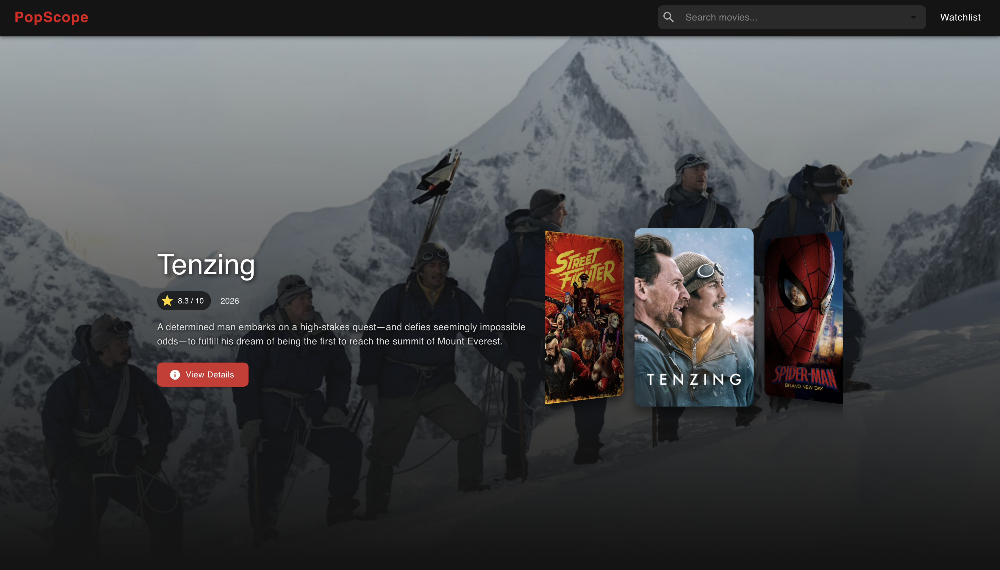
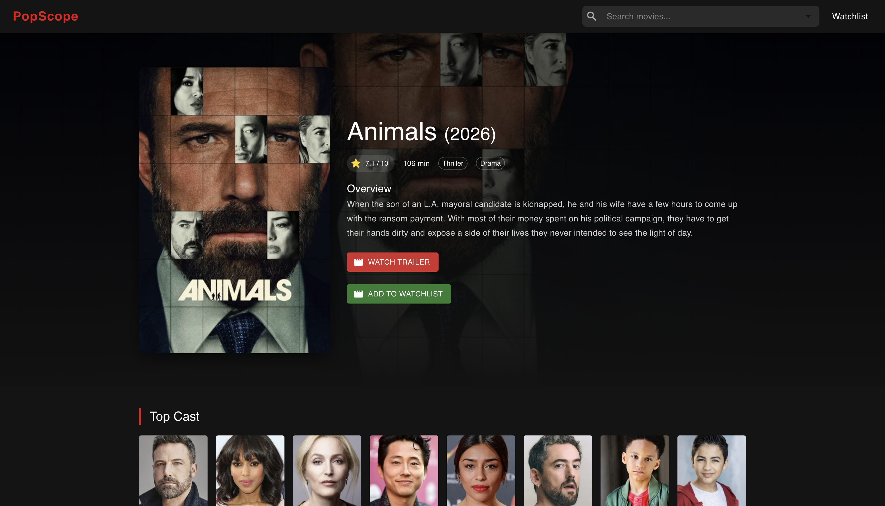
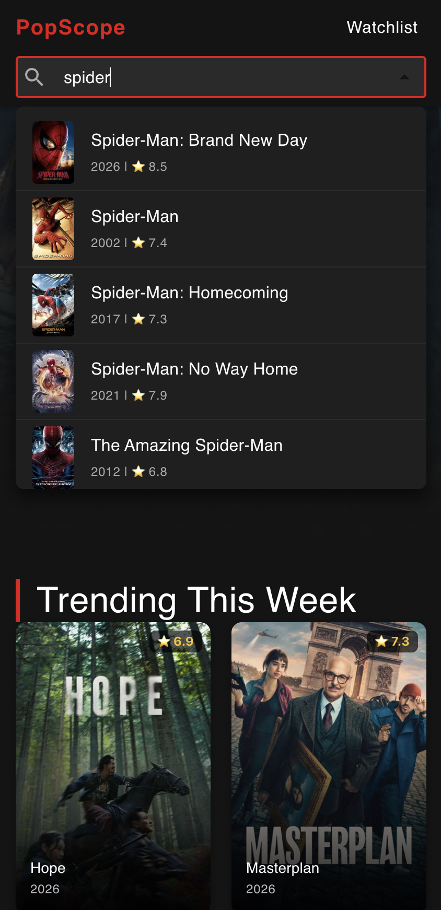

# 🍿 PopScope

A responsive movie discovery web app built with React. Browse trending movies, search with live suggestions, explore full movie details with cast and trailers, and keep a personal watchlist that persists between visits.

**🔗 Live Demo:** [popscope.vercel.app](https://popscope.vercel.app/)

## ✨ Features

- 🎞️ **Hero showcase**: an auto-playing Swiper coverflow carousel of trending movies, with a dynamic backdrop and overview that follow the active slide
- 📈 **Trending This Week** grid with hover overlays showing title, year, and rating
- 📄 **Pagination** synced with the URL (`?page=2`), so pages can be shared and bookmarked
- 🔍 **Live search** with autocomplete: debounced requests, request cancellation with `AbortController`, loading indicator, and an error state with a Retry button
- 🎬 **Movie details**: poster, rating, runtime, genres, overview, top cast, and an embedded official YouTube trailer
- ⭐ **Watchlist**: add and remove movies, with data saved in `localStorage` so it survives page refreshes
- 💀 **Skeleton loaders** while data is loading
- ⚠️ **Error handling** with friendly messages and retry buttons across pages
- 🚫 Custom **404 page**
- 📱 **Fully responsive** layout, including a full-width search on mobile
- ⬆️ Scroll resets to the top on every route change

## 🛠️ Built With

- [React 19](https://react.dev/)
- [React Router 7](https://reactrouter.com/) (`react-router-dom`)
- [Material UI 9](https://mui.com/)
- [Swiper 14](https://swiperjs.com/)
- [Axios](https://axios-http.com/)
- [TMDB API](https://developer.themoviedb.org/docs)
- Create React App (`react-scripts`)
- Context API + `useReducer` for watchlist state management

## 🚀 Getting Started

1. Clone the repo

```bash
   git clone https://github.com/Muhammed-Medhat/PopScope.git
   cd PopScope
```

2. Install dependencies

```bash
   npm install
```

3. Get a free API key from [TMDB](https://www.themoviedb.org/settings/api) and create a `.env` file in the project root:

```
   REACT_APP_TMDB_API_KEY=your_api_key_here
```

4. Start the app

```bash
   npm start
```

## 📁 Project Structure

```
src/
├── components/   # Navbar, SearchBar, ScrollToTop
├── contexts/     # WatchListContext (provider + hook)
├── reducers/     # watchListReducer
└── pages/        # Home, MovieDetails, WatchList, NotFound
```

## 📸 Screenshots

### Home



### Movie Details



### Mobile Search



## 📄 Attribution

This product uses the TMDB API but is not endorsed or certified by TMDB.
