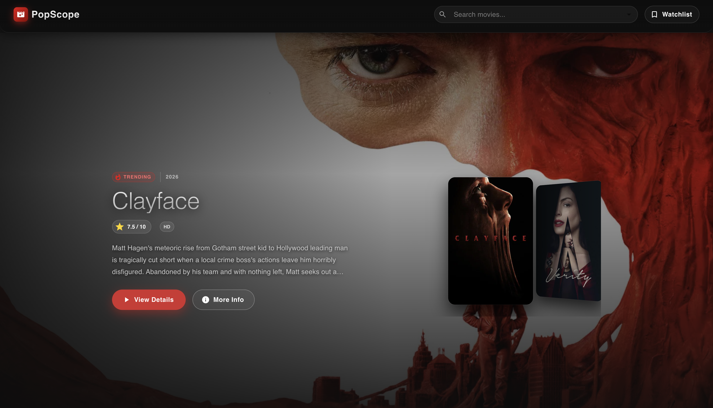
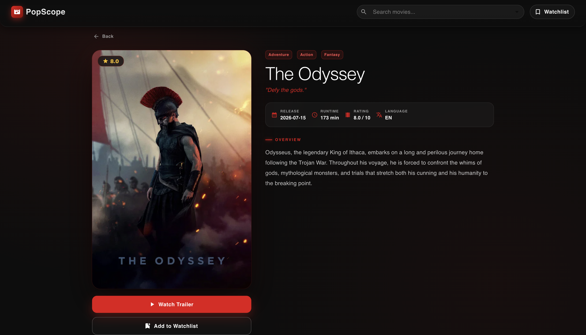
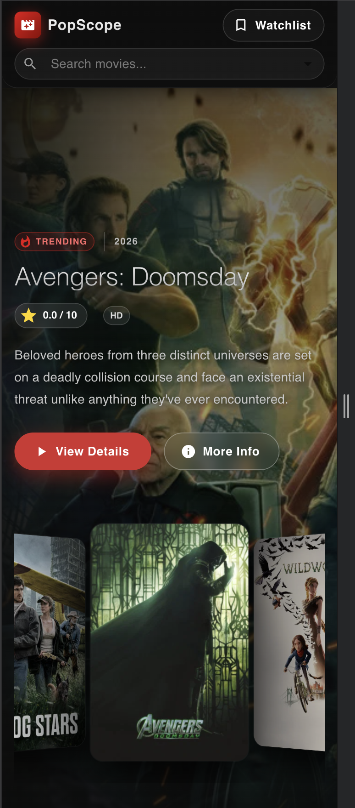

# 🍿 PopScope

A responsive movie discovery web app built with React. Browse trending movies, search with live suggestions, explore full movie details with cast and trailers, and keep a personal watchlist that persists between visits.

**🔗 Live Demo:** [popscope.vercel.app](https://popscope.vercel.app/)

## ✨ Features

- 🎞️ **Hero showcase**: an auto-playing Swiper coverflow carousel of trending movies, with a dynamic backdrop and overview that follow the active slide
- 📈 **Trending This Week** grid with hover overlays showing title, year, and rating
- 📄 **Pagination** synced with the URL (`?page=2`), so pages can be shared and bookmarked
- 🔍 **Live search** with autocomplete: debounced input, automatic request cancellation, loading indicator, and an error state with a Retry button
- 🎬 **Movie details**: poster, rating, runtime, genres, overview, top cast, and an embedded official YouTube trailer
- ⭐ **Watchlist**: add and remove movies, with data saved in `localStorage` so it survives page refreshes
- 💀 **Skeleton loaders** while data is loading
- ⚠️ **Error handling** with friendly messages and retry buttons across pages
- 🚫 Custom **404 page**
- 📱 **Fully responsive**
- ⚡ **Smart caching & background refetching** powered by TanStack Query (per-movie, per-page, and per-search-query caching)

## 🛠️ Built With

- [React 19](https://react.dev/)
- [React Router 7](https://reactrouter.com/) (`react-router-dom`)
- [Material UI 9](https://mui.com/)
- [TanStack Query v5](https://tanstack.com/query/latest) — server-state management, caching, and request deduplication
- [Swiper 14](https://swiperjs.com/)
- [Axios](https://axios-http.com/)
- [TMDB API](https://developer.themoviedb.org/docs)
- Create React App (`react-scripts`)
- Context API + `useReducer` for client-side watchlist state

## 🚀 Getting Started

1. Clone the repo

```bash
   git clone https://github.com/Muhammed-Medhat/PopScope.git
   cd PopScope
```

2. Install dependencies

```bash
   npm install
```

3. Get a free API key from [TMDB](https://www.themoviedb.org/settings/api) and create a `.env` file in the project root:

```
   REACT_APP_TMDB_API_KEY=your_api_key_here
```

4. Start the app

```bash
   npm start
```

## 📁 Project Structure

The project is organized by feature: each page (or feature) owns its components, custom hooks, constants, and skeletons under its own folder inside `components/`. All network calls go through a single centralized service layer, and every data-fetching hook wraps TanStack Query with a well-defined `queryKey`, `queryFn`, and `select`.

```
src/
├── components/
│   ├── Navbar.jsx
│   ├── Footer.jsx
│   ├── ScrollToTop.jsx
│   │
│   ├── home/
│   │   ├── hooks/
│   │   │   └── useTrendingMovies.js    # TanStack Query hook for trending
│   │   ├── constants.js                # IMG_BASE, placeholder image
│   │   ├── HomeHero.jsx                # Hero section (backdrop + info)
│   │   ├── HomeHeroSkeleton.jsx        # Loading state for hero
│   │   ├── HeroSwiper.jsx              # Coverflow carousel
│   │   ├── TrendingSection.jsx         # Grid + pagination
│   │   ├── MovieCard.jsx               # Reusable movie card
│   │   ├── MovieCardSkeleton.jsx       # Loading state for card
│   │   ├── SectionHeader.jsx           # Section title with accent bar
│   │   └── HomeErrorState.jsx          # Error UI with retry
│   │
│   ├── movie-details/
│   │   ├── hooks/
│   │   │   └── useMovieDetails.js      # TanStack Query hook (details + videos)
│   │   ├── constants.js                # Color palette, placeholders
│   │   ├── DetailSectionHeader.jsx     # Reusable section header
│   │   ├── MoviePosterSection.jsx      # Poster + CTA buttons
│   │   ├── MovieInfoPanel.jsx          # Title, meta bar, overview
│   │   ├── CastCard.jsx                # Reusable cast card
│   │   ├── CastSection.jsx             # Horizontal cast scroller
│   │   └── TrailerSection.jsx          # Embedded YouTube trailer
│   │
│   ├── search/
│   │   ├── hooks/
│   │   │   ├── useDebouncedValue.js    # Debounce utility for input
│   │   │   └── useMovieSearch.js       # TanStack Query hook for search
│   │   └── SearchBar.jsx               # Autocomplete search input
│   │
│   └── watchlist/
│       ├── constants.js                # Placeholder image
│       ├── WatchlistHeader.jsx         # Title + counter
│       ├── EmptyWatchlist.jsx          # Reusable empty state
│       └── WatchlistCard.jsx           # Reusable watchlist card
│
├── contexts/
│   └── WatchListContext.jsx            # Provider + hook
│
├── reducers/
│   └── watchListReducer.js             # add / remove actions
│
├── services/
│   ├── api.js                          # Axios instance + interceptors + baseURL
│   ├── endpoints.js                    # All TMDB endpoint paths (single source of truth)
│   └── modules/
│       └── tmdb.service.js             # Service layer using api.js + endpoints.js
│
├── pages/
│   ├── Home.jsx                        # Orchestration + local UI state
│   ├── MovieDetails.jsx                # Orchestration + local UI state
│   ├── WatchList.jsx                   # Orchestration + local UI state
│   └── NotFound.jsx                    # Custom 404
│
├── App.js                              # QueryClientProvider + routes
├── index.js
```

## 🧱 Architecture Highlights

- **Feature-based structure**: every feature owns its components, custom hooks, constants, and skeletons under `components/<feature>/`, making each feature self-contained and easy to locate. The `search/` folder follows the same pattern as `home/`, `movie-details/`, and `watchlist/`.
- **Three-layer API design**:
  - `services/api.js` — one configured Axios instance (base URL, API key, interceptors)
  - `services/endpoints.js` — every TMDB endpoint path in one place (single source of truth)
  - `services/modules/tmdb.service.js` — the only file that imports both and exposes clean functions (`getTrending`, `getMovieDetails`, `getMovieVideo`, `getMovieBySearch`)

  This separation means changing a base URL, adding an interceptor, or updating an endpoint path never requires touching the service layer or any hook.

- **Co-located data hooks**: each feature has its own `hooks/` folder that wraps TanStack Query (`useTrendingMovies`, `useMovieDetails`, `useMovieSearch`). The page component never calls `tmdbService` directly — it only calls the hook and reads `data`, `isLoading`, `isError`, and `refetch`.
- **Reusable UI pieces**: components like `MovieCard`, `WatchlistCard`, `EmptyWatchlist`, `DetailSectionHeader`, and `SectionHeader` are shared across pages, keeping the visual language consistent and reducing duplication.
- **Predictable page files**: each page (`Home`, `MovieDetails`, `WatchList`) is now a thin orchestration layer — local UI state, layout, and delegation to feature hooks. Data fetching and caching are handled entirely by TanStack Query.
- **Isolated constants**: colors, placeholder images, and shared literals live in per-feature `constants.js` files, so a theme tweak happens in one place per feature.

## ⚡ Data Fetching with TanStack Query

All server-state is managed by **TanStack Query v5**, configured once in `App.js` via `QueryClientProvider`:

```js
const queryClient = new QueryClient({
  defaultOptions: {
    queries: {
      staleTime: 1000 * 60 * 5, // 5 minutes
      retry: 2,
      refetchOnWindowFocus: false,
    },
  },
});
```

Key patterns used across the app:

- **Structured query keys** — `["trending", page]`, `["movie", id]`, `["search", query]` — so each page, movie, or search term is cached independently.
- **`select` for shape control** — hooks return only what the UI needs (e.g. `{ movies, totalPages }` for trending, `{ movie, cast, trailerKey }` for details), keeping page components free of data-shape logic.
- **`enabled` guard** — search and details queries only run when there is a meaningful input (`enabled: trimmed.length > 0`, `enabled: Boolean(id)`).
- **Automatic request cancellation** — TanStack Query passes an `AbortSignal` to `queryFn`, so switching movies or typing quickly cancels the previous request without manual `AbortController` wiring.
- **Debounced search** — a small `useDebouncedValue` hook delays the query key update, so the search endpoint is only hit once the user stops typing for 300ms.
- **`refetch()` for retries** — error states call `refetch()` directly, eliminating manual `retryCount` state.

## 📝 Refactor Notes

The project recently went through two structural refactors that **did not change any behavior, API contracts, or business logic**:

### 1. Feature-based component split

- Reorganized all TMDB endpoints into a **three-layer API**: `api.js` (Axios), `endpoints.js` (paths), and `modules/tmdb.service.js` (service functions)
- Split the previously large page files (`Home`, `MovieDetails`, `WatchList`) into focused, reusable components
- Extracted per-feature `constants.js` files
- Introduced a `search/` feature folder to match the structure of `home/`, `movie-details/`, and `watchlist/`

### 2. Migration to TanStack Query v5

- Replaced manual `useEffect` + `useState` + `AbortController` data fetching in `Home`, `MovieDetails`, and `SearchBar` with custom TanStack Query hooks (`useTrendingMovies`, `useMovieDetails`, `useMovieSearch`)
- Added a `useDebouncedValue` hook to preserve the search debounce behavior
- Kept `services/modules/tmdb.service.js` as a pure Axios layer — no TanStack Query logic leaked into the service
- All request/response contracts, API endpoints, and UI behavior remain identical

If you're comparing against an earlier version of this repo, expect to see file moves, component splits, and custom data hooks — but the app should behave exactly the same, with the added benefit of caching, deduplication, and automatic request cancellation.

## 📸 Screenshots

### Home



### Movie Details



### Mobile Responsive



## 📄 Attribution

This product uses the TMDB API but is not endorsed or certified by TMDB.
